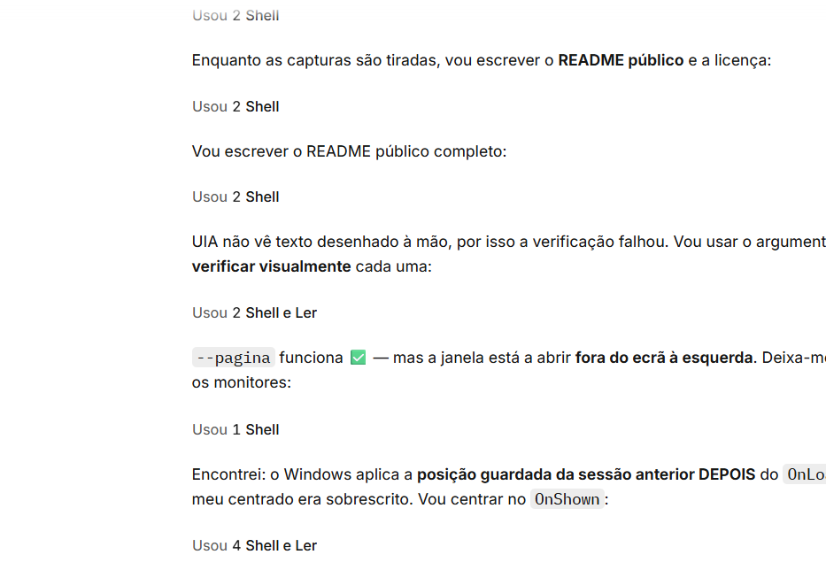
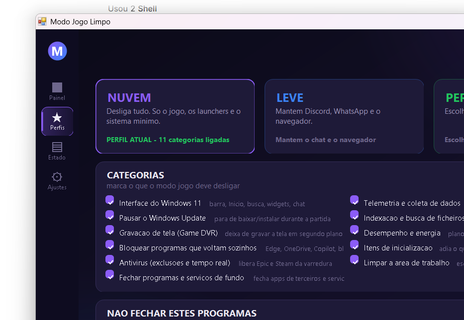
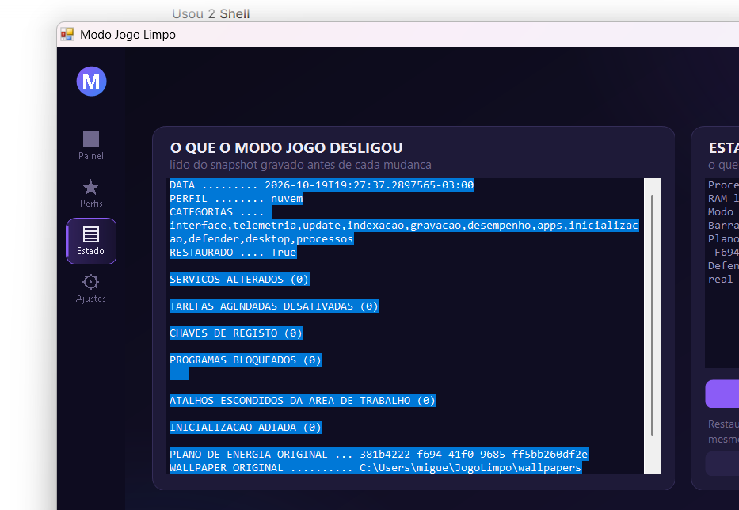
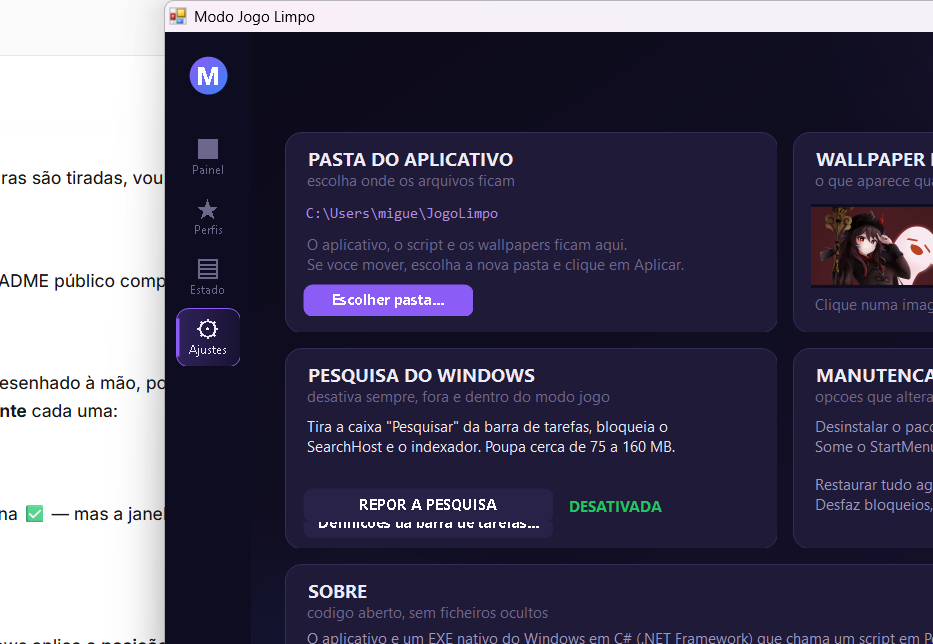

<div align="center">

# 🎮 Modo Jogo Limpo

**Um aplicativo para Windows 11 que deixa o PC como uma sessão de cloud gaming:
só o jogo, os launchers e o mínimo do sistema — e que volta *exatamente* ao
estado em que estava.**

Aplicativo nativo em C# (.NET Framework) + motor em PowerShell.
Sem dependências externas. Código aberto.

</div>

---

## O que é

O [GeForce Now](https://www.nvidia.com/pt-pt/geforce-now/) e o [Blacknut](https://www.blacknut.com/)
correm o jogo num ambiente limpo, isolado do teu PC. O **Modo Jogo Limpo** faz
a mesma coisa **localmente**: desliga tudo o que não é jogo, esconde a interface
do Windows 11, pausa as actualizações e deixa o sistema leve — e depois
**desfaz tudo, ao milímetro**.

```text
Antes         Depois (modo jogo)      Após "modo normal"
─────────────────────────────────    ────────────────────────────
240 processos  148 processos          volta ao estado original
2,2 GB RAM     2,9 GB RAM livres      plano de energia original
26 serviços    85 serviços            tarefas reativadas
2,8 GB wasted  ~0,4 GB wasted         ícones da área de trabalho de volta
```

---

## 🖼️ O aplicativo

| Painel | Perfis | Estado | Ajustes |
|---|---|---|---|
|  |  |  |  |

---

## ✨ Funcionalidades

### Três perfis

| Perfil | O que faz |
|---|---|
| ☁️ **Nuvem** | Desliga tudo. Só o jogo, os launchers e o sistema mínimo. O mais leve. |
| 🎮 **Leve** | Mantém Discord, WhatsApp e o navegador. Não mexe no Update. |
| ⚙️ **Personalizado** | Escolhes categoria por categoria (11 disponíveis). |

### O que o modo jogo desliga

- **Interface do Windows 11** — barra de tarefas escondida, menu Início, barra
  de pesquisa, widgets, chat, Cortana e notificações desligados
- **Telemetria** — 34 serviços de recolha de dados, tarefas agendadas de
  compatibilidade e a política de telemetria a `0`
- **Windows Update** — pausado durante a sessão (volta ao estado original depois)
- **Indexação e busca** — o Windows Search e o indexador param
- **Gravação de tela** — Game DVR desligado (deixa de gravar em segundo plano)
- **Desempenho** — plano "Desempenho Máximo", CPU mínima a 100%, sem suspensão
  USB nem PCIe
- **Programas que voltam sozinhos** — 59 programas bloqueados (Edge, OneDrive,
  Copilot, widgets, bloatware…)
- **Itens de inicialização** — adiados até ao fim
- **Antivírus** — exclusões para o Epic e o Steam, com protecção em tempo real
  desactivada durante a partida
- **Área de trabalho** — fica só o ícone do aplicativo, o Epic, o Steam e os
  teus jogos
- **Processos e serviços de fundo** — fecha o que não é jogo

### 🔒 O que NUNCA é tocado

Estas regras estão no código e são a razão de o aplicativo não partir o teu PC:

- **O WebView2** (`msedgewebview2.exe`) — é o motor de interface da Epic, do
  Roblox e da própria pesquisa do Windows 11. Bloquear ou matar o WebView2 deixa
  a janela **preta** e a aplicação não funciona. *(Este bug aconteceu e foi
  corrigido — vê o histórico do git.)*
- **O driver de vídeo, o áudio e a rede**
- **O Explorador** (é ele que desenha o wallpaper)
- **O anti-cheat** — Easy Anti-Cheat, BattlEye, GameGuard, XignCode, nProtect e
  Valve Anti-Cheat nunca são fechados nem bloqueados. Se um destes morrer, o
  jogo dá erro e não arranca.
- **Os serviços térmicos do Acer** (Care Center e Experience Zone)
- **O TokenBroker** — é o login Microsoft usado pela Epic e pela Store

---

## 🧠 A ideia principal: o snapshot

A maioria dos "modos jogo" da internet desligam coisas e **nunca mais
ligam**. Este grava o estado **antes** de mexer e desfaz tudo a seguir.

```
%LOCALAPPDATA%\ModoJogoLimpo\snapshot.json
```

O snapshot guarda, item a item:

- cada serviço alterado (e o seu **tipo de arranque original**)
- cada tarefa agendada
- cada chave de registo (com o valor anterior, ou a informação de que
  **não existia**)
- o **plano de energia** que estava activo
- as exclusões do antivírus que já existiam
- os itens de inicialização
- os atalhos da área de trabalho

O "modo normal" lê o snapshot e desfaz tudo. **Se o snapshot não puder ser
lido, nada é alterado** (falha segura).

O mesmo snapshot protege o teu anti-cheat: se o modo jogo desligar um serviço
de anti-cheat, ele volta exactamente como estava.

---

## 🛡️ O vigilante

Um temporizador dentro do aplicativo corre de 2 em 2 segundos e:

- fecha a **pesquisa** do Windows (é uma app UWP: o Windows relança-a sempre)
- fecha os **programas que voltam sozinhos** — widgets, painel de notícias do
  Início, assistants, OneDrive, browser, bloatware do fabricante
- volta a **esconder a barra de tarefas** quando o Windows a mostra

Corre mesmo com o aplicativo minimizado. Liga e desliga na página **Perfis**.

---

## ⌨️ Atalhos

| Atalho | Acção |
|---|---|
| `Ctrl` + `Alt` + `J` | Activar o modo jogo |
| `Ctrl` + `Alt` + `M` | Voltar ao modo normal (emergência) |

Também funciona: `ModoJogo.exe --pagina=perfis` abre directo num separador.

---

## 📥 Instalar

1. Descarrega o [`ModoJogo.exe`](ModoJogo.exe) para uma pasta tua (por exemplo
   `C:\JogoLimpo`).
2. Cria um atalho para ele no ambiente de trabalho.
3. Executa. Vai pedir autorização de administrador (é preciso para mexer em
   serviços, tarefas e registo).

O aplicativo funciona a partir de **qualquer pasta** — encontra o script e os
wallpapers ao lado de si. Se quiseres mudar de pasta, usa o botão
**"Mudar pasta..."** na página *Ajustes*.

### Wallpapers

Coloca as tuas imagens na pasta `wallpapers\`. O aplicativo usa-as todas: o
modo jogo aplica a que escolheres e a página *Ajustes* mostra as duas
primeiras. Sem imagens, funciona na mesma (mantém o wallpaper do Windows).

---

## 🔧 Compilar a partir do código

Precisas do **.NET Framework 4.x** (o `csc.exe` já vem com ele).

```cmd
build.cmd
```

Compila os `.cs` da pasta `app\` para `ModoJogo.exe`, com o ícone e o
manifesto (que pede administrador e ativa o DPI por monitor).

---

## 📁 Estrutura

```
ModoJogo.exe      aplicativo e interface (C#, .NET Framework)
ModoJogo.ps1      o motor: snapshot, perfis, restauro, pesquisa
build.cmd         compila os .cs para o .exe
app\              código-fonte C#
  ModoJogo.cs       janela principal, páginas, vigilante
  UI.cs             paleta, cartões, botões, controlos desenhados à mão
  SeletorWallpaper.cs
  GerarIcone.cs     gera o ícone do aplicativo
  app.manifest
wallpapers\      as tuas imagens
docs\            capturas de ecrã
```

---

## ⚙️ Opções de linha de comandos

```powershell
.\ModoJogo.ps1 -Acao Ativar    -Perfil nuvem -DryRun   # mostra o plano sem tocar em nada
.\ModoJogo.ps1 -Acao Ativar    -Perfil leve
.\ModoJogo.ps1 -Acao Ativar    -Perfil personalizado -Categorias "interface,telemetria,processos"
.\ModoJogo.ps1 -Acao Desativar
.\ModoJogo.ps1 -Acao Busca     -EstadoBusca on         # desactiva a pesquisa
.\ModoJogo.ps1 -Acao Estado
```

`-DryRun` imprime exactamente o que ia ser feito, sem alterar nada. É a forma
segura de ver o plano antes de o aplicar.

---

## 📌 Notas honestas

- **A caixa "Pesquisar" da barra de tarefas** no Windows 11 24H2 é guardada pelo
  shell num sítio que o registo não controla. O botão *"Definições da barra de
  tarefas..."* abre a página certa das Definições do Windows (um clique). Durante
  o modo jogo isso não se vê, porque a barra de tarefas está escondida.
- **O "modo normal" não reabre as aplicações que fechou** (Edge, WebView,
  Copilot…). É o comportamento de um modo jogo a sério. A lista *"Não fechar
  estes programas"* deixa-te poupar as que usares.
- **O antivírus com protecção em tempo real desactivado** é uma escolha, não um
  esquecimento: ganha-se FPS mas abre-se uma janela de segurança durante a
  partida. As exclusões para o Epic e o Steam são sempre aplicadas.
- Atinge-se ~148 processos num PC com 8 GB. Chegar a 60-80 exigiria desligar
  serviços do sistema **em todo o arranque** (comompartilhamento de `svchost`),
  o que obriga a reiniciar e traz risco de o Windows não arrancar. Não está
  incluído de propósito.

---

## 📄 Licença

[MIT](LICENSE) — usa, copia, modifica e distribui à vontade.

Feito com **[OpenCode](https://opencode.ai)**.
