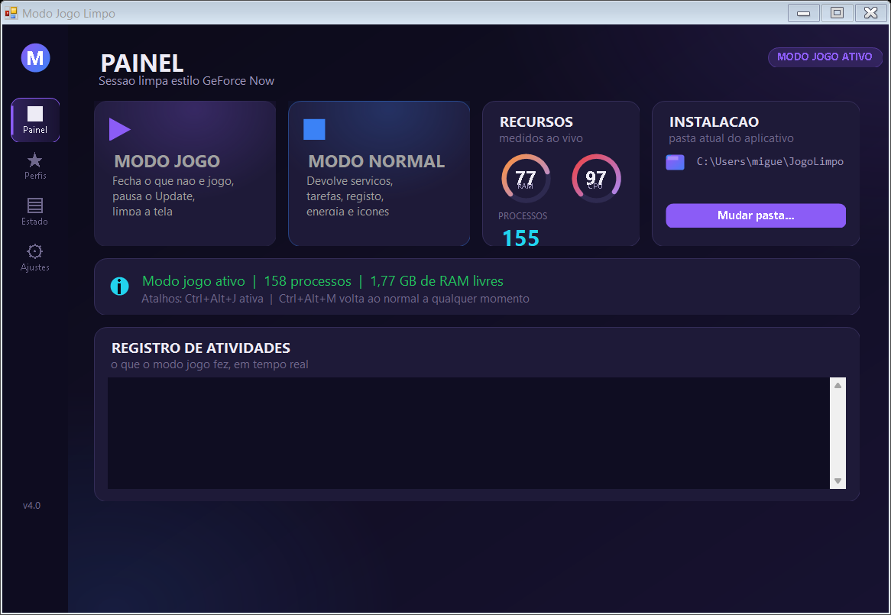
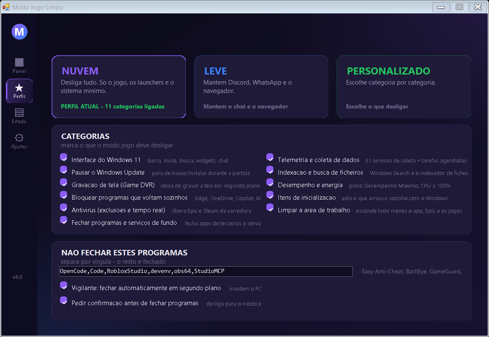
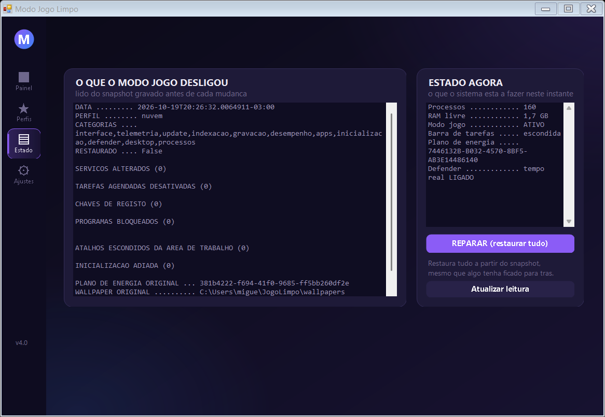
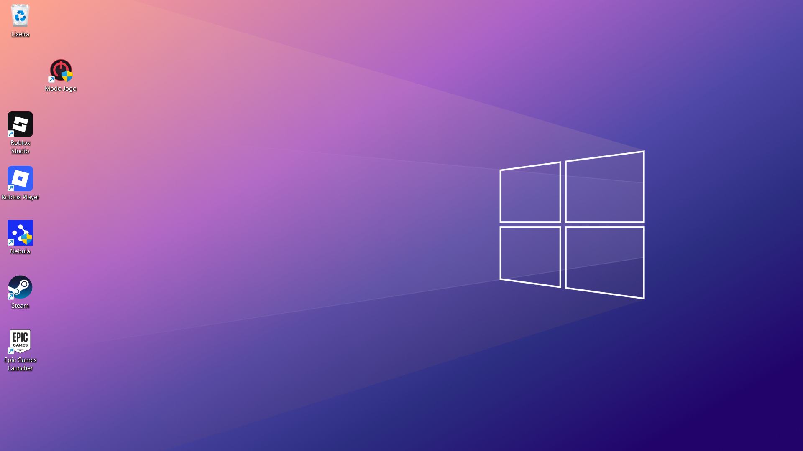

<div align="center">

# 🎮 Modo Jogo Limpo

### O teu PC como uma sessão de cloud gaming — e volta **exactamente** ao que estava.

[](https://hellmet64f.github.io/modo-jogo-limpo/)
[](https://github.com/Hellmet64f/modo-jogo-limpo/releases/latest)
[](https://github.com/Hellmet64f/modo-jogo-limpo/releases)
[]()
[](LICENSE)
[](https://github.com/Hellmet64f/modo-jogo-limpo)

<br/>

[](https://github.com/Hellmet64f/modo-jogo-limpo/releases/latest/download/ModoJogoLimpo-v4.0.zip)

[**🌐 Abrir o site do projeto →**](https://hellmet64f.github.io/modo-jogo-limpo/)

</div>

---

<div align="center">

> ### ⚠️ Isto está em **BETA**
> Funciona e foi testado em vários PCs, mas **pode ter bugs**.
> Testa sempre antes de uma sessão longa e grava o teu trabalho.

</div>

<div align="center">

| 🤝 **Feito para ajudar** | 🛡️ **Não é um vírus** | 🔓 **Código aberto** |
|:---:|:---:|:---:|
| Fecha o que está a roubar-te recursos e **devolve tudo** depois. | Não envia dados, não abre portas, não se esconde. Grava o estado **antes** de mexer e mostra-te tudo. | Todo o código é público. **Podes fazer a tua versão.** |

</div>

---

## 📸 O aplicativo em funcionamento

<div align="center">

### Modo **jogo ligado** — 148 processos, 2,9 GB de RAM livres



<br/>

<details>
<summary><b>Ver as outras páginas com o modo jogo ligado</b></summary>

<p align="center">


</p>

<p align="center">

</p>

</details>

### E o ecrã quando o modo jogo está a correr



</div>

---

## 📊 O que muda, medido num PC com 8 GB

| | Antes | Modo jogo | Depois de voltar |
|---|---:|---:|---|
| **Processos** | 240 | **148** | volta ao original |
| **RAM livre** | 2,2 GB | **2,9 GB** | volta ao original |
| **Serviços a correr** | 126 | **85** | volta ao original |
| **Tarefas agendadas** | 144 | 142 | **144** |
| **Plano de energia** | Equilibrado | Desempenho Máximo | **Equilibrado (o teu)** |
| **Planos de energia criados** | — | 1 temporário | **0** (é apagado) |

---

## 🧠 A ideia principal: o snapshot

A maioria dos "modos jogo" da internet **desligam coisas e nunca mais ligam**.
Este faz o inverso.

```
   snapshot.json  ──►  desligar tudo  ──►  jogar  ──►  snapshot.json  ──►  tudo como estava
```

Antes de mexer em alguma coisa, o aplicativo grava o estado anterior de
**tudo** num ficheiro de texto que podes abrir e ler tu mesmo:

```
%LOCALAPPDATA%\ModoJogoLimpo\snapshot.json
```

- cada **serviço** (e o seu tipo de arranque original)
- cada **tarefa agendada**
- cada **chave de registo** (com o valor anterior — ou a informação de que *não existia*)
- o **plano de energia** que estava activo
- as **exclusões do antivírus** que já existiam
- os **itens de inicialização**
- os **atalhos da área de trabalho**

O "modo normal" lê esse ficheiro e desfaz item a item.

> **Se o snapshot não puder ser lido, nada é alterado.** Falha segura.
> E existe o `-DryRun`, que mostra exactamente o que ia ser feito **sem tocar em nada**.

---

## 🔓 100% de controlo — nada é uma caixa negra

Este aplicativo **nunca te pede confiança**. Espera que acredites.

- **Vês tudo** o que vai ser desligado, na página *Estado*, antes de acontecer.
- **Cada alteração é reversível** — e o reverso é exacto, não aproximado.
- **O snapshot é um ficheiro teu.** Abre, lê, edita à mão se quiseres.
- **Perfil personalizado**: escolhes categoria por categoria o que desliga.
- **O código está todo aberto**, nas tuas mãos.

---

## ✨ Funcionalidades

### ☁️ Três perfis

| Perfil | O que faz |
|---|---|
| **☁️ Nuvem** | Desliga tudo. Só o jogo, os launchers e o sistema mínimo. O mais leve. |
| **🎮 Leve** | Mantém Discord, WhatsApp e o navegador. Não mexe no Update nem no rato. |
| **⚙️ Personalizado** | Escolhes categoria por categoria (11 disponíveis). |

### 📦 As 11 categorias

| Categoria | O que desliga |
|---|---|
| **Interface do Windows 11** | barra de tarefas escondida, menu Início, barra de pesquisa, widgets, chat, Cortana, notificações |
| **Telemetria e recolha de dados** | 34 serviços de recolha, tarefas agendadas de compatibilidade, política de telemetria a `0` |
| **Windows Update** | pausado durante a sessão (volta ao estado original depois) |
| **Indexação e busca** | o Windows Search e o indexador de ficheiros |
| **Gravação de tela** | Game DVR desligado — deixa de gravar o teu ecrã em segundo plano |
| **Desempenho e energia** | plano "Desempenho Máximo", CPU mínima a 100%, sem suspensão USB nem PCIe |
| **Programas que voltam sozinhos** | 59 programas bloqueados (Edge, OneDrive, Copilot, widgets, bloatware…) |
| **Itens de inicialização** | adiados até ao fim da sessão |
| **Antivírus** | exclusões para o Epic e o Steam, com a protecção em tempo real desactivada durante a partida |
| **Área de trabalho** | fica só o ícone do app, o Epic, o Steam e os teus jogos |
| **Processos e serviços de fundo** | fecha o que não é jogo e para os serviços que só pesam |

### 👻 O vigilante — fica a trabalhar em segundo plano

O Windows relança sozinho vários programas (a pesquisa, os widgets, o painel de
notícias do Início, os assistants, o OneDrive, o browser). O **vigilante** é um
temporizador dentro do aplicativo que, **de 2 em 2 segundos**:

- fecha a **pesquisa** do Windows (é uma app UWP: o Windows volta a arrancá-la,
  e sem o vigilante ela volta a aparecer e a comer ~160 MB)
- fecha os **programas que se autolançam**
- volta a **esconder a barra de tarefas** quando o Windows a mostra

Corre **mesmo com o aplicativo minimizado** — fica lá a trabalhar enquanto
jogas. Liga e desliga na página *Perfis*.

### 🔒 O que NUNCA é tocado

Estas regras estão no código e são a razão de o aplicativo não partir o teu PC:

- **O WebView2** (`msedgewebview2.exe`) — é o motor de interface da Epic, do
  Roblox e da própria pesquisa do Windows 11. Bloquear ou matar deixa a janela
  **preta** e a aplicação não funciona. *(Este bug aconteceu, foi diagnosticado
  e corrigido — vê o histórico do git.)*
- **O anti-cheat** — Easy Anti-Cheat, BattlEye, GameGuard, XignCode, nProtect e
  Valve Anti-Cheat nunca são fechados nem bloqueados. Se um destes morrer, o
  jogo dá erro e não arranca.
- **O driver de vídeo, o áudio e a rede**
- **O Explorador** (é ele que desenha o wallpaper)
- **O TokenBroker** — é o login Microsoft usado pela Epic e pela Store
- **Os serviços térmicos do Acer** (Care Center e Experience Zone)

---

## ⌨️ Atalhos

| Atalho | Acção |
|---|---|
| `Ctrl` + `Alt` + `J` | Activar o modo jogo |
| `Ctrl` + `Alt` + `M` | Voltar ao modo normal (emergência) |

O aplicativo **minimiza-se sozinho** quando activa o modo jogo — como está
sempre no topo, tapava a janela do launcher e do jogo.

---

## 📥 Instalar

1. Descarrega o [`ModoJogoLimpo-v4.0.zip`](https://github.com/Hellmet64f/modo-jogo-limpo/releases/latest/download/ModoJogoLimpo-v4.0.zip) — **79 KB**.
2. Extrai para uma pasta tua (por exemplo `C:\JogoLimpo`).
3. Executa o `ModoJogo.exe` e aceita o pedido de administrador (é preciso para
   mexer em serviços, tarefas agendadas e no registo).

O aplicativo funciona a partir de **qualquer pasta** — encontra o script e os
wallpapers ao lado de si. Para mudar de pasta: botão **"Mudar pasta..."** na
página *Ajustes*.

### Wallpapers

Coloca as tuas imagens na pasta `wallpapers\`. O aplicativo usa-as todas: o modo
jogo aplica a que escolheres e a página *Ajustes* mostra as duas primeiras.
Sem imagens, funciona na mesma (mantém o wallpaper do Windows).

---

## 🔧 Compilar a partir do código

Precisas do **.NET Framework 4.x** (o `csc.exe` já vem com ele).

```cmd
build.cmd
```

Compila os `.cs` da pasta `app\` para `ModoJogo.exe`, com o ícone, a versão e
o manifesto (que pede administrador e ativa o DPI por monitor).

---

## 📁 Estrutura

```
ModoJogo.exe      aplicativo e interface (C#, .NET Framework)
ModoJogo.ps1      o motor: snapshot, perfis, restauro, pesquisa
build.cmd         compila os .cs para o .exe
app\              código-fonte C#
  ModoJogo.cs       janela principal, páginas, vigilante
  UI.cs             paleta, cartões, botões, controlos desenhados à mão
  SeletorWallpaper.cs
  GerarIcone.cs     gera o ícone do aplicativo
  Version.cs        informação de versão
  app.manifest
wallpapers\      as tuas imagens
docs\            o site (GitHub Pages) e as capturas de ecrã
```

---

## ⚙️ Linha de comandos

```powershell
.\ModoJogo.ps1 -Acao Ativar    -Perfil nuvem -DryRun   # mostra o plano, não toca em nada
.\ModoJogo.ps1 -Acao Ativar    -Perfil leve
.\ModoJogo.ps1 -Acao Ativar    -Perfil personalizado -Categorias "interface,telemetria,processos"
.\ModoJogo.ps1 -Acao Desativar
.\ModoJogo.ps1 -Acao Busca     -EstadoBusca on         # desactiva a pesquisa
.\ModoJogo.ps1 -Acao Estado
```

---

## 🤝 Ajudar o projeto original

O código é teu para usares, estudares e modificares à vontade — **faz a tua
versão** sem qualquer obrigação.

Mas se quiseres que o **projeto original** melhore, o caminho é:

1. **Abre uma issue** a descrever o que encontraste
2. **Manda um pull request** com a correcção
3. **Reporta um bug** com o que reproduziste — isso vale tanto quanto uma
   correcção

O historial do git conta a história toda: cada bug que foi diagnosticado e
corrigido está lá, com a explicação do porque.

---

## 📌 Notas honestas

- **A caixa "Pesquisar" da barra de tarefas** no Windows 11 24H2 é guardada pelo
  shell num sítio que o registo não controla. O botão *"Definições da barra de
  tarefas..."* abre a página certa das Definições do Windows (um clique).
  Durante o modo jogo isso não se vê, porque a barra está escondida.
- **O "modo normal" não reabre as aplicações que fechou** (Edge, WebView,
  Copilot…). É o comportamento de um modo jogo a sério. A lista *"Não fechar
  estes programas"* deixa-te poupar as que usares.
- **O antivírus com protecção em tempo real desactivado** é uma escolha, não um
  esquecimento: ganha-se FPS mas abre-se uma janela de segurança durante a
  partida. As exclusões para o Epic e o Steam são sempre aplicadas.
- Atinge-se ~148 processos num PC com 8 GB. Chegar a 60-80 exigiria desligar
  serviços do sistema **em todo o arranque** (compartilhamento de `svchost`), o
  que obriga a reiniciar e traz risco de o Windows não arrancar. Não está
  incluído de propósito.
- **Beta.** Testa antes de confiar.

---

## 📄 Licença

[MIT](LICENSE) — com um aviso legal mais completo em português e inglês.

**Copyright (c) 2026 Miguel Rafael Montana**

> Este aplicativo foi escrito e debugado com a ajuda do
> **[OpenCode](https://opencode.ai)** e de modelos de IA. Todo o código está
> disponível para leitura, verificação e crítica — incluindo o que a IA
> escreveu. Se encontrares algo errado, é um bug, e os bugs corrigem-se.

🌐 **Site do projeto:** https://hellmet64f.github.io/modo-jogo-limpo/

Feito com **[OpenCode](https://opencode.ai)**.
